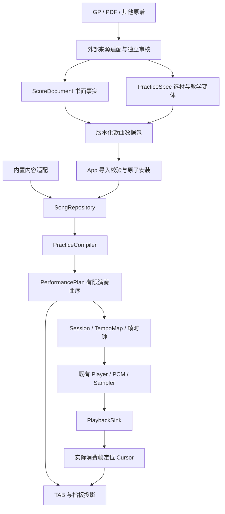

# 音乐内核与歌曲数据包重构方案

状态：**架构审查与待实施设计**。审查日期：2026-10-13。本文不表示下述新能力已经实现。

执行入口：[Agent 执行任务](音乐内核与歌曲数据包-Agent执行任务.md)。

## 1. 结论与交付边界

建议实施 A、B 两项重构，共用一套音乐语义契约：

- A：把现有短句时间轴扩展为“书面乐谱 → 练习定义 → 演奏计划 → 音频帧/显示光标”。复用当前 Player、PlaybackSink、采样器和 Compose 展示组织，替换其中只能表达单时间流的假设。
- B：外部 Agent 将 GP/PDF 等来源变为经过审核的、版本化的纯数据包；App 负责严格校验、安装到私有存储、动态建立目录，并通过 A 的同一条链路播放与制谱。
- **先交付一次支持新内核和导入的 App 升级。** 当前 v74 无运行时歌曲导入能力；升级后，符合该版本能力集的新歌曲只需导入数据包，不改 Kotlin、不重打 APK。将来新增真正未知的音乐语义仍可能需要升级 App，不能承诺任意未来乐谱永远免升级。
- 完成标准是“同一已安装 APK 连续导入未编入源码的歌曲，离线重启后可选择、显示、播放和保存设置”，并验证声明支持的音乐能力；生成 JSON、解压成功或出现目录条目均不足以证明完成。

本轮继续使用单 `:app` 模块；先划清 Kotlin 包和接口职责，不额外引入多模块、服务端、账号、插件执行器或第二套播放器。保持音阶、基础和弦、既有练习及设置兼容。首版展示仍以六线谱/指板为主，不把完整出版级五线谱编辑器、任意乐器音源和 GP RSE 音色复刻纳入本次验收。

## 2. 审查基线与已有能力

实际仓库：`C:\Users\b3322\Documents\Codex\projects\guitar-practice`；远端已现场核对为 `https://github.com/a3322505a-sys/guitar-practice-private.git`。`001` 仅为历史目录。

审查时分支 `codex/status-bar-background-v73`，HEAD `db9fc78d334e2370516a7a833ce0266a9ed74640`；工作区已包含未提交的 v73/v74 改动，`app/build.gradle.kts` 为 74 / `3.9.0-local26`。**本文基于工作区源码，不能只检出 HEAD 后按本文判断 v74 已存在。** 执行前重新确认差异并建立本地可恢复基线，不丢弃、覆盖或混入无关改动。本轮没有拉取远端，未声称本地与远端最新状态一致。

下列文件路径省略 `app/src/main/java/com/a3322505a/guitarlearning/` 前缀；行号为本轮审查定位，执行时以符号为准。

| 能力/边界 | 当前源码证据 | 结论与处理 |
| --- | --- | --- |
| 音乐事件 | `practice/Sequence.kt:10–35`，`Event.id=tick`，要求 onset 唯一 | 能表达同拍多弦和弦，但不能表达独立声部在同一时刻的多个事件；引入稳定事件/音头 ID |
| 拍号与节奏 | `Sequence.kt:25–28`、`Expression.kt:49` | 支持 2–6 个四分音符一小节、混合 n/4；每曲仅 12/24 tick。v74 已有直三十二分及三十二分三连音，不能说尚未支持 |
| 连音组 | `Expression.kt:12,49` | 仅三等分成员，要求完整/对齐/不重叠且不跨小节；不等于任意 N:M 连音组 |
| 连奏/奏法 | `Expression.kt`、`Pcm.kt` | 已有上下拨、死音、P.M.、重音/力度、短促、let ring、滑/击/勾弦、推弦曲线、装饰音、揉弦近似；保留并规范组合语义 |
| 连续覆盖 | `practice/Phrases.kt:70–109` | 全曲事件必须首尾相接覆盖时长，事件总时长等于曲长；这只适用于单声部流，不能照搬到多声部 |
| 时间与设备 | `Sequence.kt:217–243`、`audio/Player.kt:94–99`、`PlaybackSink.kt:9–25` | Session 单一 BPM，Player 以实际消费帧推进，设备输出有接口和取消代次；保留后者，替换时间换算 |
| 曲序 | `scripts/import-seven-blocks.py:84`、`practice/SevenBlocks.kt` | 七个 Block 外部展开反复，保留 sourceBars；并非通用 App 曲序模型。原 14/17/19 小节的反复次数仍待核 |
| 制谱 | `practice/TabNotation.kt:50–96`、`ui/Tablature.kt:75–197` | 有书面分段不重复起音、连线、排谱行与光标；节奏枚举、四分拍分组、`/4` 标签、单声部布局需要泛化 |
| 吉他音高 | `music/Music.kt:3–9`、`Sequence.midi` | Position 使用全局标准调弦，Sequence 叠加整夹；新轨道不能继续隐式读取标准调弦 |
| 和弦 | `Phrases.kt:90–109`、`PracticeApp.kt` 中 `Chords.named` | 名称同时承担全局查找与实际指法约束；外部曲包需要独立的和声名称和包内指法 ID |
| 来源/教学/目录 | `Phrases.kt:49–64`、`KafkaPractice.kt` | 已有来源集合、教学组合、核心/更多版本及旧 ID 迁移；应数据化其关系，不退回“所有来源都展示” |
| 设置 | `PhraseSettings.kt:6–27` | SharedPreferences 保存每 ID BPM/次数/范围，并有 Kafka/K265 兼容；保留旧键读取，加入通用资产身份与修订语义 |
| 外部生产 | `scripts/song_assets/common.py`、`gp.py`、`pdf.py`、`song-assets.py` | 已有 GPIF 引用图、Fraction 时值、来源 SHA、半开窗口、覆盖阻断和候选输出保护；值得复用 |
| 当前工具限制 | `gp.py:34,109,121–148`、`pdf.py`、`song-assets.py:104` | GP 门禁按歌限定，PDF 路径固定 4/4/12 tick；IR 固定 12 tick。SevenBlocks 是单独路径，不能直接把旧 IR 作为新公共协议 |
| 实际产物 | `song-assets.py` 生成 `.kt`，`Phrases.all` 静态注册 | 工具侧 JSON 目前不驱动 App；还没有动态 Repository、导入器或资产修订机制 |
| 性能 | `Pcm.kt:81–158` | 构造时生成各音波形，混音块遍历 voices；长曲/多声部放大会话准备和内存风险。须测量并约束，不沿用“小短句可用即全曲可用”的推断 |

本轮运行 `python scripts/test_song_assets.py`：5 项通过。未重跑 Android 构建、真机或试听；历史 v74 验证记录仅作参考，不冒充本轮结果。

## 3. 唯一权威链路



`ScoreDocument` 保留书面小节、各轨各声部、音头、连线和曲序符号；`PracticeSpec` 引用它，描述选段/拼接/练习补白/目录关系。`PerformancePlan` 是同一编译器产生的派生结果，包含经过顺序、恢复状态及音符到原谱的映射。外部工具可以生成期望曲序供审核；App 自己验证/编译，不能信任未经重算的可执行播放表。

UI、音频不读 GP/PDF，也不各自展开反复或计算速度。运行时 DTO、领域对象、排版对象不互相等同；**不要直接序列化当前 Kotlin `Phrase/Sequence` 成为长期文件格式**。不得把任意 Kotlin 类名、枚举 ordinal、脚本或表达式写入数据协议。

## 4. A：音乐内核契约

### 4.1 时间、拍号与书写节奏

1. 以四分音符为 1，使用规范化有理数 `Q={n,d}`：分母为正、约分、零为 `{0,1}`。来源、契约、校验阶段精确计算；仅绘图插值和最终秒/帧换算用浮点。旧 12/24 tick 无损变为 `tick/ticksPerQuarter`，不统一放大后四舍五入。
2. Kotlin 核心实现受界限保护的有理数运算，乘加/比较检查溢出，可用交叉约分和必要的 BigInteger 中间量；JSON 整数限制在双方精确可读范围。Python 继续使用 `Fraction`。不得为一首五连音再增设一种 PPQ。
3. `Meter` 存 `numerator`、`denominator`、`beatGroups`。首版支持常用二进制分母 1/2/4/8/16/32/64，分组单位为分母拍；例如 6/8 的 `[3,3]`、7/8 的 `[2,2,3]`。分组影响节拍重音、符杠、预备拍和拍位标签。
4. `Measure` 分开存 nominalMeter 与 actualDuration。弱起、不完整尾小节和不规则小节有显式原因，不自动填成满小节；印刷号、内部稳定 ID、来源索引分开，允许原号缺口。各轨共用全曲小节坐标；本次不支持彼此独立的多重拍号。
5. 书写值存 `baseDenominator`、`dots`、`tupletGroupIds`，另有精确实际时长供一致性检查。附点为几何级数，连音比逐层相乘。对齐小节起点计算节拍分组，不能沿用绝对 tick 取模决定所有符杠。
6. `TupletGroup` 用 ID、voiceId、成员 eventIds、actual/normal 比例、可选 parentId 和括号/数字信息表达。支持 3:2、5:4、7:4、9:8 等、不等值成员、休止成员、跨拍与嵌套；组可跨小节并保留续括号。禁止交叉但不嵌套的矛盾分组、循环父引用和算术不一致。
7. 区分来源延音线与排版拆分产生的续线。二者都不得造成重复起音；来源同音延音有独立 noteId 关系，不能只靠“长 duration”推回源谱。

连音的实际时长与书写显示分层也与 MusicXML 的 time-modification/tuplet 区分一致；这里借用语义，不把 MusicXML XML 结构原样搬进 App。[MusicXML 4.0 连音说明](https://www.w3.org/2021/06/musicxml40/musicxml-reference/elements/time-modification/)

### 4.2 多轨、多声部、音头与吉他音高

- `trackId / voiceId / eventId / noteId` 都是稳定 ID；onset 是时间，不能充当身份。同一时刻可有多个事件，不同声部可独立延音和休止。同一声部保持节奏覆盖，和弦音头共享一个书写事件；不同时值用独立声部表示。
- 显式休止只作用于所在声部，不能令其他声部停止。整个静默声部可声明整小节休止；来源缺失/未知不自动变成休止。
- 轨道持有乐器、弦序、openStringMidi、fretCount、capo；弦序统一 1 为最高音弦方向，不能沿用 GP 的编码而不转换。首版支持六弦吉他非标准调弦（含 Drop D）及整夹；部分变调夹、动态换调弦、七/八弦和非吉他音轨暂列能力外，不能静默当标准六弦播放。
- 音头保留实际弦品和可验证的实音；普通音由轨道调弦+品位+整夹导出。原谱可保留拼写/谱面八度信息，避免吉他谱高八度记谱导致双重移调。泛音单独记录触点/基音/发声音高关系。
- 同一轨同一根弦不能同时按两个冲突品位。不同声部共用同弦同音时，需要显式共同发声身份或独立重拨语义；禁止凭时间合并或发两次不应有的起音。不同轨的同名弦互不截断。
- 播放可混合选定吉他轨；界面选择一个主练轨，并同时显示其声部，可独奏/静音其他轨。指板高亮集合属于选定轨，不能把多把吉他的音位叠成一个不可弹指法。保留现有单轨练习的默认行为。
- `HarmonySymbol`（和声标记）与 `GuitarVoicing`（实际按法）分开。曲包内 voicingId 解析到实际弦品/指法，显示名称允许重复；未标和弦的旋律/复音不自动起名，旋律音也不必被强制包含于和弦卡。

### 4.3 反复曲序与练习循环

`Form` 支持反复起止/总遍数、嵌套反复、房子结尾、D.C./D.S.、Segno、Coda、To Coda、Fine 及经过条件。总遍数明确包含第一次。无条件跳转环、缺失标记、交叉反复和不明确的回跳策略必须报定位错误，不猜测。

曲序编译器维护 repeat stack、房子选择、跳转使用状态和有界展开预算，生成 `MeasureVisit(visitId, measureId, occurrence, repeatContext, entryState)`。区分：

- 原谱小节 `measureId`：书面事实；
- 本次经过 `visitId`：反复/回跳后第几次经过；
- 练习轮数 `practiceLoop`：完整演奏选定路线多少轮，0 表示一直练习。

无限练习循环由 Session 实现，不在 Score 或 Form 中无限展开。保留七个 Block 的原号/展开号显示；新曲至少支持“展开练习谱”展示路线，源谱反复符号作为来源信息保留，紧凑原谱视图不是首版交付前置。

D.C./D.S. 后是否执行某段反复、Fine/To Coda 生效经过必须在 Form 中显式或按已冻结的默认规则决定。跳转时速度/力度/和声/调弦状态从目标的已编译状态恢复，支持显式经过限定覆盖；不要把离开点的状态无意带到目标。非连续跳转默认结束持续音，只有显式有效的关系才允许跨越。

这些记号对应真实播放控制而非纯排版文本，MusicXML 的 sound 也区分跳转目标和经过条件。[MusicXML 4.0 播放参数](https://www.w3.org/2021/06/musicxml40/musicxml-reference/elements/sound/)

### 4.4 变速、摇摆与唯一时钟

- `TempoMap` 在精确乐谱位置定义速度事件：显示的 beatUnit、BPM、可选渐变终点和曲线类型。首版做阶梯变速和线性 BPM 渐变；线性曲线的自变量明确为公共演奏拍位（见下项），不含“按秒线性”的另一种解释。来源采用其他曲线时，适配器保留原语义并要求已审核转换或阻断。rit./accel. 只有文字而无终点时保留待核，不能捏造。
- 将显示 BPM 转换为四分音符 BPM。例如附点四分音符=60，对应四分音符=90；6/8 一小节持续 2 秒。BPM 的拍单位与节拍器分组独立保存。
- 先建立公共演奏拍位 p；全曲 swing 的主映射 W 将书面拍位映射到 p，速度标记也通过 W 定位。TempoMap 定义四分音符 BPM B(p)，秒为 `t(p)=∫60/B(u)du`，练习倍率再按规则作用。最终 `round(t(p)*sampleRate)` 得到绝对 Long 帧；用前缀积分和逆解供 Cursor 定位，不用每音累加取整时长。例如无 swing 的4个四分拍内60→120线性渐快，总长为 `4*ln(2)` 秒。
- 保留 2:1 八分/十六分摇摆，扩展为限定范围、voice/track 作用域和比例。声部覆盖只改变该声部事件在公共演奏轴的起止；全局小节/预备/节拍器仍依主映射，不能让不同声部各建一个会话时钟。各映射保持组端点一致，显式tuplets默认不再swing，不能摇摆两次。显示 active notes 必须查各声部已经编译的发声/书写区间，不能只以一个反算标量找出单个 event。
- 新歌曲默认按“原谱速度 × 练习倍率”保留速度变化；另设显式“固定练习速度”覆盖模式。老歌曲恢复的整数 BPM 迁移到固定模式，不能突然变成倍率；显示始终带拍单位。改变速度仍结束旧播放，从头重建，首版不做实时无缝调速。
- 预备拍按选区起点有效拍号/分组和有效速度生成完整预备小节，不把 6/8 默认读成六个四分音符。弱起可用 `leadIn` 对齐缺省的拍位，必须明确提示。
- 保留 `PlaybackSink.heardFrames → SessionClock → Cursor`，扩展 Cursor 为帧位、practiceLoop、visitId、measureId、乐谱位置、beatGroup、activeNoteIds/音位集合。TAB/指板/节拍器统一消费此映射。
- 32 位设备 playbackHead 回绕需在 sink 边界扩展为单调 Long；暂停后的旧会话回调仍由现有 generation 拦截。不要将系统墙钟当音乐权威时钟。

### 4.5 奏法必须有组合规则

| 范围 | 必须实现的语义/制谱 | 声音处理 |
| --- | --- | --- |
| 拨弦与力度 | 单音/扫弦/琶音，方向、扫弦时差，强弱/渐强渐弱、重音 | 复用采样与音量，时差由明确参数决定；不能默认一切 Up 都是扫弦 |
| 消音与延续 | 休止、死音、P.M.、短促、let ring、同音延音、显式截音 | 复用噪声/滤波/包络；截音按 track+string，不按全局下一个事件 |
| 连奏 | 击弦、勾弦、滑音（连奏/重拨/滑入/滑出）、tapping | noteId 关系确定是否重拨；复用连续采样相位与既有连奏链 |
| 音高变化 | bend、预推/保持/释放、vibrato、tremolo bar | 曲线、作用范围、深度/速率明确；先复用插值音高包络，标为采样近似 |
| 装饰与反复拨奏 | 单个或一组前/拍上装饰音、trill、tremolo picking | 明确偷前音/本音时长或拍前偏移；trill/反复拨奏按精确细分生成派生起音，不覆盖源音头 |
| 泛音 | 自然/人工/捏弦泛音，触点/发声音高和对应标记 | 实音正确，现有采样的音色近似明确记录；不能按普通品位直接算音高 |

关系分为 `Tie`、`Slur`、`Legato`：Slur 本身不推断“不重拨”。事件级默认/音头级覆盖按固定优先级解析；同一音上的 bend+vibrato 应组合，同弦的 tie+新起音、互斥滑音模式等冲突定位拒绝。旧 `Pcm` 的分支会在若干表达同时出现时只走其中一种，不能仅在 DTO 加字段就称支持组合。

每个功能能力必须分别标注 **模型可保真、TAB可显示、播放准确时序/音高、音色近似**；所有表内常见技巧在最终 A 交付中都应有数据样本和实现。不要求真实音色复刻，但不能把完全没播放语义的技巧仅存 metadata 然后宣布 A 完成。

### 4.6 选段与持续状态

`PracticeSpec` 使用稳定来源坐标的半开区间 `[start,end)`，支持多个有序段拼接；范围明确引用书面小节或已展开的经过，不能只写含糊的“第 8 小节”。每段指定主轨、参与轨/声部、曲序策略、进入/退出规则。

- 外部教学切分优先保留完整乐句和技巧关系；任意切断音符、延音、连奏、连音组必须先报诊断。
- 经审核允许切分时，用枚举 `carryIn / reattack / truncate / reject` 和受影响 noteIds 明示处理；`reattack` 是教学改编，不能改写源事实。默认教学窗口 `reject`，用户已有按小节练习保留“恢复持续状态、末尾收音”的体验。
- runtime 范围开始前计算有效调弦、速度、力度、和声、发声相位与跨界技巧；结束处用短淡出收音但不增加拍长。暂停继续仍回当前经过的小节起点，不能误回同号的第一次经过。
- `practicePadding` 与原谱 rest 分开，注明理由/来源窗口；预备拍是 Session 数据，既不伪装为原谱小节，也不写回 Score。

## 5. B：歌曲资产契约与导入

### 5.1 数据包结构

提出 `.gpractice` 作为 ZIP 容器后缀，UTF-8 JSON 为权威数据。以下是待实施的 v1 文件结构，不是现有工具输出：

```text
manifest.json          身份、协议版本、所需能力、逐文件大小与 SHA-256
score.json             ScoreDocument：书面音乐事实和 Form
practices.json         选段/教学加工/主轨/版本关系/可见目录
provenance.json        来源指纹、定位映射、转换工具版本和处理范围
review.json            审核对象哈希、覆盖数、结论与待核/近似项
```

v1 不携带原谱、音源、APK、脚本、HTML 或可执行代码。原 GP/PDF、页面截图和详细人工审阅材料留在外部审核目录，通过来源哈希/页码/原对象 ID 关联。后续如需封面或附件，作为新 capability 增加，不让导入器任意执行/加载资源 URL。

`manifest` 最小语义：

| 字段 | 约定 |
| --- | --- |
| `format` | 固定 `guitar-practice-song`；与旧工具的 `source-practice.json.schemaVersion=1` 不同命名空间 |
| `formatVersion` | major/minor；封装规则版本 |
| `scoreSchemaVersion` | major/minor；音乐数据语义版本 |
| `packageId` | 稳定、带作者命名空间的 ASCII ID，例如 `personal.your-trip`；文件名不是身份 |
| `revision` | 同一包递增正整数；曲名修改不换 packageId |
| `display` | 标题、作者/来源简述等纯文本；长度有界 |
| `requires` | 版本化 capability 集合，例如 `meter.compound.v1`、`form.volta.v1`、`technique.bend.v1` |
| `files` | 上述除 manifest 外的精确路径、字节数、原始字节 SHA-256；不允许额外文件 |

全局引用为 `packageId + localId`；localId 不能是列表下标/小节印刷号。包内 practice/track/voice/measure/event/note/voicing ID 唯一、类型明确、引用闭合。源码内旧 `S01`、`KAF-*`、`YT-*`、`SB-*` 等由受控兼容映射接入，不要求旧存储键整体改名。

SHA-256 校验完整性，不证明作者或源谱正确。审核状态也是数据，不是 App 的信任豁免。逐文件哈希使用原始字节，不自行发明跨语言 JSON hash 规范；外部打包确定字段/列表顺序、换行和 ZIP 时间戳，保证同输入可复现。manifest 不包含自己的 hash，安装时对整个容器计算 digest 作接收证据，避免循环哈希。

### 5.2 各文件的强制内容

**score.json**：documentId、轨道配置、全曲小节/拍号、每轨每声部书写事件、音头、延音/连奏等关系、连音组、速度/力度/swing、Form、和声标记及局部指法。具体类型和数值界限由 P1 JSON Schema 冻结；既有字段不靠自由文本让 Agent 自行解释。

**practices.json**：稳定 practiceId、title、goal、难度/技巧标签、suggestedTempo、引用片段、主练轨与混音轨、窗口/补白/技巧跨界策略、familyId/variantOf/relatedIds、可见层级及排序。来源不自动进入可见目录。只支持白名单的数据操作，禁止运行时表达式语言；新歌不能要求在 `Phrases` 增加按名字判断的分支。

**provenance.json**：原文件名字与 SHA-256、格式/版本、来源与许可说明、转换工具版本；GP 的 track/bar/voice/beat/note 引用链，PDF 的页码及可定位区域/坐标系；转换后的 noteId 到来源一对一/一对多关系。源谱同音延续、教学拼接、重复经过与派生装饰起音都能追溯，不把生成位置当原谱位置。

**review.json**：绑定 score/practices/provenance 的字节哈希，记录 reviewer（人/Agent）、工具版本、审核方式和结果。覆盖单位分开计数：来源范围内轨/声部/书面小节/事件/音头/休止/关系/奏法，以及演奏展开后的 visit/起音数；不能把二者混成 `skippedEvents=0`。

诊断分类统一：`supported`、`approximation`、`out-of-scope`、`review-needed`、`unsupported-blocker`。每项含 JSON pointer、来源位置、featureId、原因、影响的 practiceIds 和处理。未知音乐字段在选定范围内阻断；明确排除的非目标轨/来源页数计入 out-of-scope，而非“解析丢弃”。

默认阻断未解决且影响音高/节奏/曲序的 review-needed。已有七个 Block 等带已披露假设的内容，可以显式 `conditional` 导入：必须列出具体假设、来源未证实项和受影响练习，并在预览与练习说明可见；不得把“沿用 GP 的 2 遍”改成“原谱已确认”。conditional 不能绕过未知语义或结构错误。

### 5.3 版本与能力协商

- App 内发布机器可读能力清单，包含结构/制谱/音频级别和数值预算；外部 producer 使用对应清单预检，App 再独立校验，不只信 manifest 声称的 requires。
- 不认识的 major 或关键 feature 拒绝导入，报告“需要支持某能力的 App 版本”；不回退成普通音/4/4。未知 minor 只在已声明的兼容规则允许时接受；核心音乐字段严格、未知字段拒绝，只有 `extensions` 命名空间可保存已声明非音乐扩展。
- 能力集由实际数据重新推导并核对 requires，防止包省略要求而误进旧 App。音色近似需可展示说明；结构/时序不支持不能用“近似”吞掉。
- Schema major 升级使用显式迁移器生成新候选，不覆盖旧包；内置和外部包使用同一验证器。P1 冻结后，任何破坏变更先写迁移与旧样本，不随实现便利悄改字段。

### 5.4 导入事务、存储与更新

用系统文件选择器 `ACTION_OPEN_DOCUMENT` 接收 content URI，读取并复制到 App 私有 staging，支持 `.gpractice` 及提供者返回的通用 ZIP/二进制 MIME；不依赖真实磁盘路径或长期保留外部 URI。Android 的 SAF 提供用户选择单个文件的入口，无需为此申请全盘访问。[Android 文件选择文档](https://developer.android.com/training/data-storage/shared/documents-files)

处理顺序：

1. URI 限量读取 → 容器检查 → manifest/原始字节哈希 → Schema → 引用/音乐语义 → capability → 编译预算检查。
2. 后台完成所有昂贵操作，结果形成可预览候选；取消/失败不进入目录，也不干扰当前播放。
3. 显示歌曲、练习数、修订、覆盖范围和重要近似/假设；同 ID 新修订显示更新对象。用户选择“导入/更新”即提交，不再叠加重复授权弹窗。
4. 候选在私有目录完成验证后成为不可变 revision 目录，再原子替换单个 active-index。包文件、索引和设置不能靠多次独立写入假装一个事务。
5. 目录发布一个不可变快照；重启根据索引加载。中断发生在索引切换前继续旧版，切换后使用完整新版；孤立 staging/未激活 revision 仅在确认无引用后清理。

推荐布局：`filesDir/songs/<packageId>/<revision>-<digest>/...`，加 `active-index.json` 和 `staging/<importId>/`。包身份先经受限字符校验，落盘目录再 canonical 校验。索引可使用 AtomicFile 风格单文件提交；单进程导入串行，revision 目录写完并同步后才提交指针。保留前一有效版本以回退。

冲突规则：同 ID/同 revision/同 digest 幂等返回；同 revision 不同内容拒绝并要求 producer 增加 revision；高 revision 作为更新；低 revision 只经显式回退流程；外部不能覆盖保留的内置 namespace，也不能通过 alias 抢占其他包。

正在播放时 Session 钉住 packageId/revision/digest 和已编译计划。后台导入发布目录后，当前会话继续原内容；用户主动切换/应用更新时走现有停止旧会话逻辑。运行中引用的版本不删除。App 被杀后恢复选择/设置，不自动恢复播放。

首版限制作为资源契约的一部分：建议压缩输入 16 MiB、解压总量 64 MiB、单 JSON 32 MiB、条目数 16、JSON 深度 48、轨数 8、每轨声部 4、书面小节 10,000、音头 200,000、展开 visit 50,000、连音嵌套 4 层、反复嵌套 4 层。P1 用真实样本核定，发布为有版本的 limits；超限明示拒绝，不截断。时间运算分母/分子与编译后帧数也需上限。

ZIP 必须拒绝路径越界、绝对路径、反斜杠/重复或规范化碰撞路径、符号链接、加密/嵌套压缩及未声明条目；按实际解压字节而不是 header 宣称大小计数。JSON 拒绝重复键、非有限数和过深结构。Android 官方说明 ZIP 路径不会自动验证，需要在解压目标检查。[Android ZIP 路径遍历说明](https://developer.android.com/privacy-and-security/risks/zip-path-traversal)

### 5.5 Repository、目录与设置迁移

`SongRepository` 合并内置来源和已激活导入包，提供不可变 catalogue 快照、`resolve(PracticeKey)`、按需读取/编译。旧 Phrases 可暂作 built-in provider；Repository 不解谱、不发声，UI 不直接访问磁盘或解析 JSON。

- UI 仍由 `PracticeApp` 协调导航/播放器，既有 Controls/Content/Transport/Settings 保持展示和回调边界；在设置增加“本地曲库/导入”最小入口、导入状态/错误和轨道选择，不顺带重做其他页面。
- 来源条目、核心练习、更多版本、和弦指法采用包内显式数据；删除 `startsWith("KAF-")` 等面向新歌的扩展需求，内置 legacy mapping 仍保留兼容。
- 保留 `practice-settings`，旧 phrase 键按原规则读；新键使用明确编码的 packageId/practiceId 命名空间，不能简单拼接有歧义的任意字符串。
- 选择存稳定 ID，范围存来源/visit 锚点与 routeFingerprint；修订后范围仅在锚点可验证时迁移，否则回整句并说明。速度/次数不因小节数变化而全清空。
- 旧 Kafka 与 K265 alias 由可信内置映射提供，新包的 alias 仅限自己 namespace，检测循环与一对多歧义。
- 删除/禁用外部包先撤销目录激活，缺失选择回现有合法默认，其他歌曲设置不动；不清空原谱或手机外部文件。索引单条损坏隔离该包，内置练习仍可启动。

## 6. 外部 Agent 的标准生产流程

共享底座复用 `gp_graph`、`Fraction`、fingerprint、来源窗口和报告思路；旧工具保持可运行及受保护输出，逐步增加通用 emitter。不要把 song-specific profile 改个 songId 就称通用导入器。

1. **清点来源**：只读保留原 GP/PDF；计算 SHA、辨认格式、轨道/声部/页码、调弦/夹、拍号/变速/反复/技巧，列出本次目标范围及排除范围。
2. **来源适配**：按格式版本读取，GPIF 保留引用链；其他 GP 版本通过确实支持的解析器/应用导出标准格式，再对照原文件审阅。PDF 是转录流程，复用 Your Trip 提取/注释工具中可通用部分，不能承诺任意 PDF 自动无误。
3. **生成书面事实**：保留原音头、时值、休止、位置和符号；转谱工具可能丢的效果逐项核对，未识别音乐项阻断，不自动转成注释。原谱格式适配与最终曲包协议无关。
4. **教学拆分**：按音乐句界建立 PracticeSpec，保留来源与教学修改差异、整段关系及实际前后音。填写核心/版本、建议速度、目标；重排/简化不得冒充原曲逐字复现。
5. **独立审核**：来源再读或逐页/逐小节对照，建立不由同一生成器自我导出的期望数据；核对音高/弦品/书面节奏/声部/曲序/技巧/选区，未知重复次数不猜。生成器自己的往返测试只能验证序列化一致。
6. **本地校验与打包**：结构、音乐语义、能力、预算、关系闭合、覆盖计数全部通过后，绑定 review 哈希并输出新候选包，禁止覆写非空审核目录。
7. **App 端审核**：导入到已安装支持版本，检查实际目录/完整谱面/指板/播放/切段/重启恢复。报告分别列外部来源审核、程序校验、真机操作和真人听感/实弹，不能互相代替。

拟新增的工具入口（**目前尚不存在，P7 实现**）：

```text
python scripts/song-package.py inspect  --source <score> --output <new-dir>
python scripts/song-package.py normalize --manifest <selection> --source <score> --output <new-dir>
python scripts/song-package.py validate --candidate <dir> --capabilities <app-capabilities.json>
python scripts/song-package.py pack --candidate <reviewed-dir> --output <new-file.gpractice>
```

所有入口统一 exit code、结构化诊断和输出路径；`pack` 不替代审核，也不能通过 CLI 参数把 blocker 改成通过。产物包与审核目录分别交付，歌曲生产应能在只有工具/契约而没有 Android 源码的目录完成。

## 7. 代码职责与复用安排

以下为建议位置，执行时可调整文件粒度；职责和单一权威不变。

| 建议入口 | 负责 | 从现有代码复用/替换 |
| --- | --- | --- |
| `music/score/` | Rational、ScoreDocument、音头/声部/拍号/关系、语义校验 | 扩展现有音乐事实，保留 Position 的几何价值；新轨音高不读全局调弦 |
| `practice/compile/` | 选段、Form 展开、TempoMap、PerformancePlan、索引 | 接续 Sequence/Session 规则，旧 12/24 tick 由 LegacySequenceAdapter 无损导入 |
| `practice/Session.kt` 等 | 会话控制、预备/循环/恢复、帧与Cursor映射 | 保留用户会话语义，移出 Sequence.kt 内已增大的职责 |
| `practice/notation/` | 声部分层、节拍分组、符杠/连音/连线、source/visit映射 | 复用 TabNotation/tabSystems，替换枚举时长和单声部假设 |
| `audio/Player.kt`、`PlaybackSink.kt` | 单一输出、取消/焦点/生命周期/消费帧 | 原路演进，不另起播放器 |
| `audio/Pcm.kt`/Sampler | 从编译计划读取音符/包络/混音 | 复用音源、噪声、P.M.、continuous phase；从全曲预渲染转为有界按需声音实例 |
| `assets/song/` | DTO、严格 JSON 解码、包校验、安装事务、Repository | 新增必要边界，领域核心不依赖 Android Context |
| `practice/PhraseSettings.kt` | 旧键兼容、通用身份与修订范围恢复 | 保留旧映射，禁止清档迁移 |
| `ui/` | 曲库入口、主轨选择、统一多声部投影 | 复用现有组件和状态回调；底部/平板尺寸无关样式不改 |
| `scripts/song_assets/` | 适配、来源审核、候选与包生成 | 保留既有保护输出，按格式提取共性，特殊来源注释留在 data/manifest |
| `contracts/song-package/v1/` | 规范、Schema、能力表、原创正反例 | 新增跨语言共享的测试输入与预期诊断 |

JSON 库只负责有界解析/DTO；Kotlin 必须有明确语义校验器。先检查已缓存依赖再选库，最多增加必要解析/校验依赖，不为这一边界引入庞大框架。Schema 验证可以由外部工具执行，App 用等价的严格解码/语义检查；两端用共享正反例防漂移，不能声称两套实现天然一致。

过渡期允许旧 Sequence 构造内置内容，由 adapter 转入新编译路径；不允许永久保留“旧歌一个播放器、新歌另一个播放器”。adapter 只处理旧模型能表达的内容，不把新模型压扁回旧 Event。完成迁移后旧生成 Kotlin 作为历史/回归参照，常规新增歌曲全部走数据包。

## 8. 实施阶段与依赖

| 阶段 | 内容 | 依赖 | 可验收产物 |
| --- | --- | --- | --- |
| P0 | 冻结工作区兼容基线、源/设置/布局样本与资源测量条件 | 无 | 文件/版本快照，旧歌曲期望投影，明确遗留未核项 |
| P1 | 同时冻结 A 领域语义与 B v1 契约/能力/限制 | P0 | Schema、规范、原创正反例、错误码、Python/Kotlin契约校验骨架 |
| P2 | Rational、拍号、书写值、音头/多声部/调弦、legacy adapter | P1 | 不同拍号/连音/声部的精确域模型及兼容投影 |
| P3 | Form、选段、TempoMap、状态恢复与SessionClock | P2 | 有界演奏路线、绝对帧映射和统一Cursor |
| P4 | 接入既有Player/PCM、TAB/指板、多声部与按需调度 | P3 | 内置旧曲与原创复杂谱走同一链路，可实际操作 |
| P5 | 数据包导入事务、Repository、目录/设置接入；最小pack工具 | P4 | 第一条未编入APK的原创简单曲可导入、练习、重启恢复 |
| P6 | 全部常见奏法与组合、完整能力表、长曲资源校验 | P4；与P5共享冻结契约 | A 的能力矩阵通过，B可接受对应复杂包 |
| P7 | 通用外部生产CLI、来源审核/教学关系数据化、既有歌曲迁移 | P5+P6 | GP/PDF→审核→包闭环，曲目特判退出新增歌曲流程 |
| P8 | 一次正式升级、同APK多包导入/更新/失败恢复验收 | P7 | A+B完整交付及设备证据、生产手册 |

先做一条可运行的动态导入纵向链路，再扩大来源格式；不能用单音示例通过 P5 就宣布 A+B 完成。P5/P6 可在职责明确时交错，但本方案不要求多 Agent 并行。

## 9. 验收矩阵

### 9.1 内核的原创最小样本

| 样本 | 必查结果 |
| --- | --- |
| 3/4→6/8→7/8（2+2+3）→5/4，含弱起 | 小节长精确；拍号标签/分组/符杠/预备一致；6/8 附点四分=60 时一小节2秒 |
| 附点/复附点、64分、五连/七连、混合时值/休止连音、嵌套/跨小节组 | 实际时值与书写值一致；没有音符因量化消失；组边界可读 |
| 两声部同拍，低音延长+高音旋律，高声部休止 | noteId 不冲突、低音不被休止截断；同弦非法冲突拒绝；两个吉他轨互不截音 |
| 反复+一二房、嵌套、D.S.al Coda、D.C.al Fine | 逐 visit 期望序列匹配，正确停止；选第二次经过可恢复；错误环/目标拒绝 |
| 拍中60→90阶梯变速、60→120渐变、swing+显式tuplets | onset/节拍/光标同一积分映射；关键点正反帧映射误差≤1帧；多轮绝对边界不累计漂移 |
| tie与排版续线、h/p/slide链、bend+vibrato、泛音、trill/tremolo、装饰音 | 音头/派生起音数正确，音高/时序可测，TAB可区分；音色近似仍独立披露 |
| 跨小节持续音/技巧选段、非连续拼接、暂停恢复 | carry/reattack/truncate按策略执行；末尾无额外拍，原谱数据不变 |
| Drop D 与 capo、谱面八度/实音区分 | 同音位点音、TAB、和弦标签与正式播放使用同一轨配置 |

两端共用原创 fixture，但期望值不能由待测编译器自动生成。真实源曲审核仍需独立原谱/原始夹具。

### 9.2 内置兼容与动态包验收

- 复用 `CoreTest/KernelTest/NotationTest/PhraseSettingsTest`、各歌曲来源/渲染测试和 Python 测试；先测直接受影响模块，收口时跑全套。迁移后比较音高、弦品、精确起止、力度/技巧、曲序、核心/版本和旧选择，不只比较文件字节。
- v72 旧工具受保护 Kotlin/CSV 在未切换 emitter 前仍逐文件相等；新包表示与旧 Kotlin 不要求字节相同，要求语义投影相同。独立来源 CSV 不由新生成器重写来消除失败。
- 固定已安装 APK 哈希，外部目录生产此前不存在的原创曲包；正常文件选择导入，断网可操作，重启恢复设置。第二包必须至少含复拍/不规则拍、多声部、非三连音、反复结尾和变速等组合；还需真实 GP 与 PDF 来源各一条通过审核的包验证外部链路。
- 同包重复导入、新修订、冲突修订、回退、未知能力、坏引用/错误时值、哈希不符、重复 JSON key、路径越界、超限包、中断/进程死亡、撤销 URI/外部原包删除均有直接证据；失败不得使旧库不可用。
- 当前播放遇到导入更新/删除请求，验证版本钉住；旧设置/其他曲目不清空；曲包可通过数据定义新和弦指法和教学版本，无须修改全局 Chords/Phrases。
- 最终安装用现有长期签名覆盖升级，保留数据；至少安装和启动，设备可用时完成上述实际导入/练习。没有设备时交付可核验实现与包，明确“真机验收未完成”，不能把模拟 Activity 成功当真机通过。

### 9.3 长曲/性能验收边界

长曲是本次新增能力的直接风险，必须有界测量：旧短句、密集旧solo、新多声部长曲（例如10分钟、4轨、每轨2声部）以及超限反例。记录设备/采样率/速度/音开关、准备时间、峰值内存、稳态块生成耗时和欠载证据。

编译索引应支持按时间检索 active notes/当前小节，音频块只扫描活动集合及邻近事件；缓存有上限，不能按反复次数物化整首 PCM。UI 不在每帧重复解析、校验、排全谱。采样算法可复用，波形生命周期需按长曲重整。

P0 确定同机基线；P4/P6 选择一个稳定运行预算（块生成 p99 应留在块时长内并有余量，且不出现持续欠载，内存不随循环轮数线性增长）。数据超预算要给出诊断/限制，不能通过静默丢音“达标”。无需新建全项目覆盖率或截图数量门槛。

## 10. 明确风险与不应采用的捷径

- 放大 PPQ 不能解决多声部、书写节奏/曲序身份、泛音音高或导入契约；本次不要再增加“某曲专属 tick 档位”。
- 仅对现有 Phrase 做 JSON 反序列化会固化单声部、全局和弦、固定 BPM 等限制，后续新曲仍需改内核。
- 遇到未知技巧/曲序只留文本、继续普通音播放，会让“导入成功”掩盖音乐错误；必须 capability 协商或显式阻断。
- 用旧歌曲生成器自己的输出作唯一来源证明，不能发现原始抽取错误；独立审核必须保留。
- 用一个新 ViewModel/Repository 名称包住全局静态 Phrases，不等于动态资产完成；以不重装 APK 的实际新包测试收口。
- 单次代码重排不是本次目标。所有新增边界要由上述能力或验收需要证明，避免同时改外观、课程系统、账号/网络或项目构建拓扑。

## 11. 本轮实际交付与继续入口

本轮只新增本方案和 [Agent 执行任务](音乐内核与歌曲数据包-Agent执行任务.md)，保留既有未提交代码与文档，不改 App 版本、不构建或安装 APK、不提交/推送。源码审查确认已有能力和限制，Python 资产测试 5 项通过；新契约、内核和动态导入均待后续按阶段实施。

实现 Agent 应先读执行任务，再按 P0 核对当前仓库是否已变化。遇到新的原谱事实可以修正设计，但应记录原因、受影响契约/夹具及迁移方案，不能悄悄缩减 A 或 B 的完成条件。
